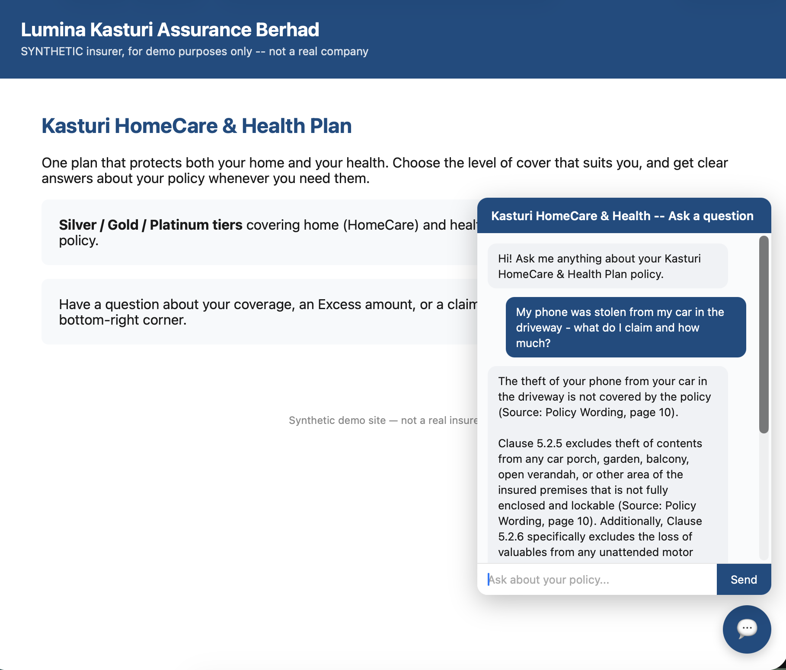
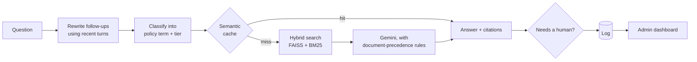
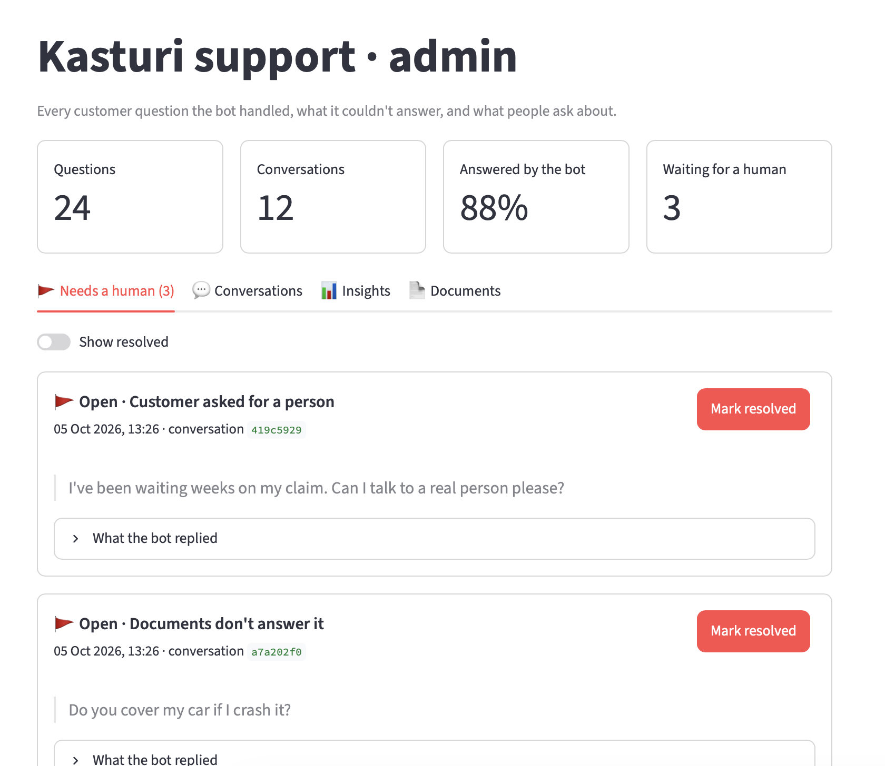
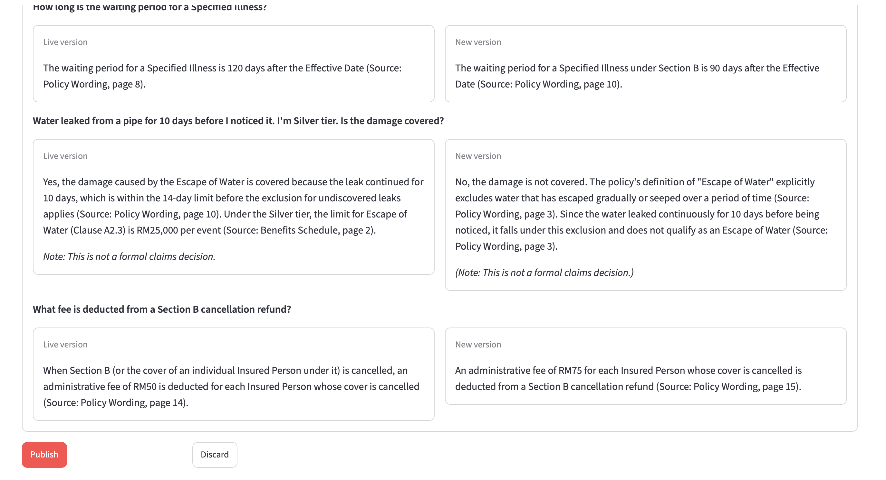

# Grounded RAG Assistant for Insurance Policies

An AI support bot that answers customer questions about an insurance policy using **only the insurer's own documents**, citing the document and page for every fact. It comes with an admin dashboard for staff.



> The four policy PDFs are synthetic: an invented insurer and product modelled on real Malaysian general-insurance documents.

## How it answers

Insurance answers depend on several documents with different authority. The closest-matching passage is often the wrong one:

| Customer asks | Naive answer | Correct answer |
|---|---|---|
| "My house flooded. Gold tier, no Special Perils Extension. Covered?" | Yes, 50% of Sum Insured | **Not covered.** Flood needs the Extension (Clause A4.1). |
| "My phone was stolen from my car in the driveway." | Quotes the phone limit | **Not covered.** Exclusion 5.2.6 applies. |
| "My kitchen pipe burst and damaged my floor. Silver tier." | Finds nothing | **Covered:** RM25,000 limit, RM1,000 Excess |

## How it works



- **Table-aware PDF parsing:** every benefits-table row keeps its Silver/Gold/Platinum headers, and every passage is tagged with its document and policy section.
- **Grounded answers:** exclusions are checked before amounts, the contract outranks the summary, and every fact is cited.

## Results

| | |
|---|---|
| Trick questions answered correctly | **19 / 21** runs (7 per question; phone theft 5 / 7: twice it asked for the tier instead of answering) |
| Answer passage found by search | **13 / 13** questions |
| Wrong cached answers on near-miss questions | **0%** (answers are reused only for near-identical questions) |
| Follow-up questions answered correctly | **4 / 4** (1 / 4 without memory) |

## Highlights

- **Fixed cut-off answers** by tracing them to thinking tokens using up the output budget. Unfinished answers are now never shown or cached.
- **Raised search recall from 12/13 to 13/13** by adding a second search on the policy term alone.
- **Made the cache safe**: a cached answer is reused only when the policy term and tier match and the question is near-identical, because raw similarity gave wrong answers on near-miss questions at every threshold.

## Admin dashboard

Headline numbers, a "needs a human" queue, searchable conversation transcripts, and topic insights.



**Updating documents:** an admin uploads a new version of a policy PDF, reviews a check report and a side-by-side comparison of answers, then publishes. The bot switches without a restart, and earlier versions can be restored in one click.



## Run it

```bash
cp .env.example .env        # add your GEMINI_API_KEY and an ADMIN_PASSWORD
docker compose up --build
```

Chat widget: http://localhost:8000 · Dashboard: http://localhost:8501 · Sample data: `python3 scripts/seed_demo.py`

Tests (no API key needed): `pip install -r requirements-dev.txt && pytest`

Before deploying beyond a demo, restrict the chat API's allowed origins (CORS) to the insurer's site and add rate limiting, since every question costs Gemini calls.

## Tech stack

Python · Gemini · sentence-transformers · FAISS · BM25 · LangChain · pdfplumber · FastAPI · SQLite · Streamlit · Docker

## License

Code: [MIT](LICENSE). The policy PDFs are synthetic documents created for this project.
