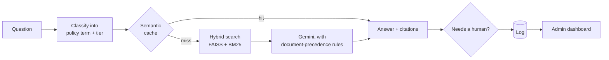
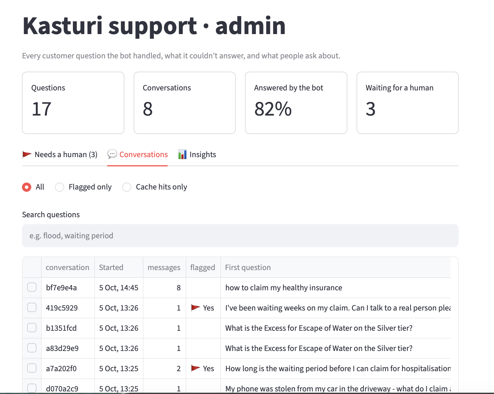
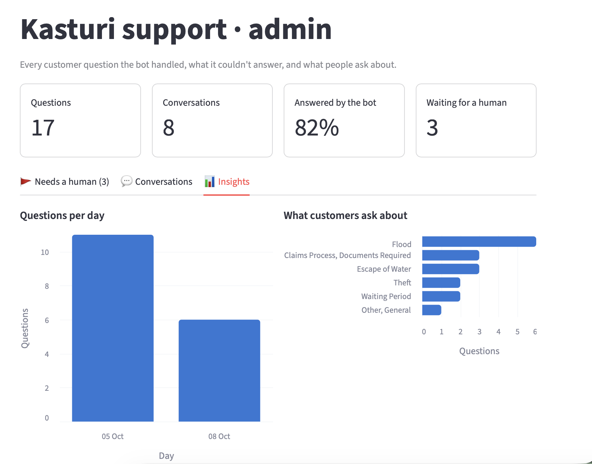

# Insurance Policy Q&A Bot

An AI support bot that answers customer questions about an insurance policy using **only the insurer's own documents**, citing the document and page for every fact. It comes with an admin dashboard for staff.


> The four policy PDFs are synthetic: an invented insurer and product modelled on real Malaysian general-insurance documents.

## How it answers

Insurance answers depend on several documents with different authority. The closest-matching passage is often the wrong one:

| Customer asks | Naive answer | Correct answer |
|---|---|---|
| "My house flooded. Gold tier, no Special Perils Extension. Covered?" | Yes, 50% of Sum Insured | **Not covered.** Flood needs the Extension (Clause A4.1). |
| "My phone was stolen from my car in the driveway." | Quotes the phone limit | **Not covered.** Exclusion 5.2.6 applies. |
| "My kitchen pipe burst and damaged my floor. Silver tier." | Finds nothing | **Covered:** RM25,000 limit, RM1,000 Excess |

## How it works



- **Table-aware PDF parsing:** every benefits-table row keeps its Silver/Gold/Platinum headers, and every chunk is tagged with its document and policy section.
- **Hybrid retrieval:** vector and keyword search, guided by a classifier that maps plain language to policy terms ("burst pipe" → *Escape of Water*).
- **Grounded answers:** exclusions are checked before amounts, the contract outranks the summary, and every fact is cited.
- **A safe semantic cache:** an answer is reused only for the same policy term and tier.
- **Escalation:** a conversation is flagged for staff when the documents don't answer it or the customer asks for a person.

## Results

| | |
|---|---|
| Trick questions answered correctly | **21 / 21** runs |
| Answer passage found by search | **13 / 13** questions |
| Wrong cached answers on near-miss questions | **0%** |

## Highlights

- **Fixed cut-off answers** by tracing them to thinking tokens using up the output budget. Unfinished answers are now never shown or cached.
- **Raised search recall from 12/13 to 13/13** by adding a second search on the policy term alone.
- **Made the cache safe** by matching on classified policy terms, since raw similarity failed on near-miss questions at every threshold.

## Admin dashboard

Headline numbers, a "needs a human" queue with resolve/reopen, searchable conversation transcripts, and topic insights.


| Conversations | Insights |
|---|---|
|  |  |

## Run it

```bash
cp .env.example .env        # add your GEMINI_API_KEY
docker compose up --build
```

Chat widget: http://localhost:8000 · Dashboard: http://localhost:8501 · Sample data: `python3 scripts/seed_demo.py`

## Tech stack

Python · Gemini · sentence-transformers · FAISS · BM25 · LangChain · pdfplumber · FastAPI · SQLite · Streamlit · Docker
